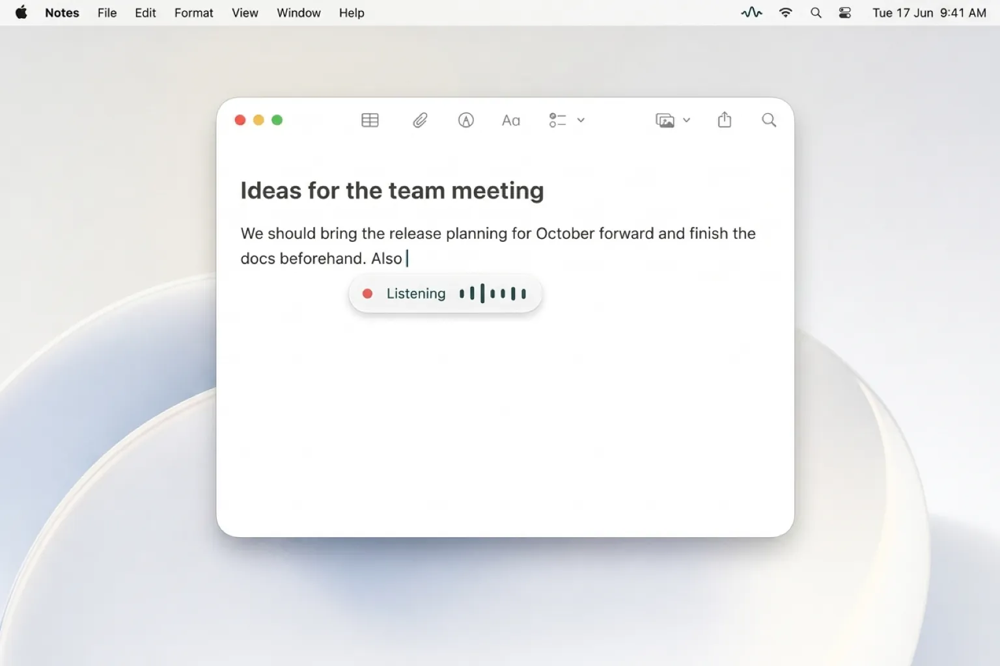
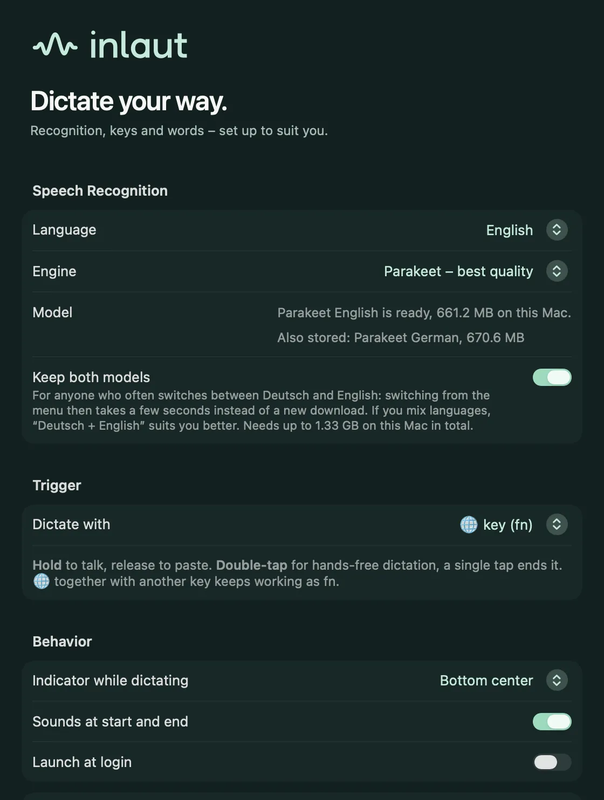

# inlaut

[](https://www.bestpractices.dev/projects/15409)

A local dictation app for macOS, with a native Windows beta. Hold a key combination, speak, let go — the text appears in whatever text field has the cursor. The macOS features below use Apple's on-device models; the Windows beta uses its own bundled recognition models.

<p align="center"></p>

inlaut is free and open source (GPL-3.0). It is a local alternative to cloud dictation apps such as Wispr Flow, and to Superwhisper or MacWhisper if dictation into any app is all you need: no account, no subscription, no AI rewriting. Website: [inlaut.de](https://inlaut.de) (German) and [inlaut.de/en](https://inlaut.de/en); a sourced [comparison of Mac dictation apps](https://inlaut.de/en/compare) lists where each one recognises speech and what it costs.

- **Local only.** Speech is recognised on this Mac. No account, no cloud, nothing stored.
- **German and English, also mixed.** Uses [Parakeet Ultra](https://huggingface.co/moondream/parakeet-ultra), a post-training of NVIDIA Parakeet TDT 0.6B v3, as Core ML on the Neural Engine through [FluidAudio](https://github.com/FluidInference/FluidAudio). It handles technical terms and anglicisms far better than the recogniser built into macOS and writes ß. A 10-second dictation is text in well under 0.1 s on an M3; two minutes take about one second.
- **Light.** The model (≈ 630 MB, downloaded and checksum-verified once on first start) stays loaded at about 50 MB of app memory and loads in 0.2 s, so dictation starts the moment you press the key. Speech recognition does no work while idle and the microphone is only open while you dictate.
- **Replacements.** Fix what the recogniser keeps getting wrong ("Dum" → "DAM").
- **Snippets.** A spoken phrase inserts a longer stored text (signature, bank details). Replacements and snippets can be exported and imported as a file.
- **Tidy up dictations.** Optional: leaves out filler sounds ("um") and words said twice by accident. "Resolve self-corrections" (beta, optional) turns "on Monday, no, on Tuesday" into "on Tuesday"; Apple's on-device language model confirms each case on this Mac. inlaut only removes words and never rephrases.
- **Recordings.** "Transcribe File …" turns an audio or video file into text in its own window, with optional time stamps. It opens what macOS can decode (MP3, M4A, WAV, FLAC, MP4, MOV …) and WebM recordings with Opus audio, as browsers and web meeting tools write them. Five minutes of audio take a few seconds; the transcript is only stored if you save it.
- **Fallback.** Apple's on-device recogniser (`SpeechAnalyzer`) is prepared independently and used until Parakeet is ready. macOS may need to download its language assets. Selecting Apple releases the Parakeet model from memory once any current dictation finishes.
- **Updates.** Sparkle checks daily for signed releases, with download and installation started by the user. Automatic checks can be disabled in Settings. No dictation data or system profile is sent.

<p align="center"></p>

## Design

The app and website use the **Sprachimpuls / Petrol & Mint** brand kit, with native system typography and light/dark appearances. See [design/README.md](design/README.md) for the source assets and reproducible integration.

## Download for macOS

[Download inlaut 0.5.0](https://github.com/tobymarks/inlaut/releases/download/v0.5.0/Inlaut-0.5.0-en.dmg) ([German disk image](https://github.com/tobymarks/inlaut/releases/download/v0.5.0/Inlaut-0.5.0.dmg)) for Apple Silicon and macOS 26 or later. Open the DMG, drag inlaut onto the Applications folder, then open inlaut from Applications. You can eject the disk image after copying. Both the app and the DMG are Developer ID signed and notarized by Apple.

Or with Homebrew:

```bash
brew install --cask tobymarks/tap/inlaut
```

Setup downloads the speech model (around 630 MB) and guides you through microphone and Accessibility permissions. [Release notes and checksums](https://github.com/tobymarks/inlaut/releases/latest).

## Windows beta

[Download inlaut 0.7.0-beta.9 for Windows x64](https://github.com/tobymarks/inlaut/releases/download/windows-v0.7.0-beta.9/inlaut-0.7.0-beta.9-windows-x64-setup.exe). This is an **unsigned beta** for Windows 10/11, with German and English dictation and independently selectable interface language. Windows may show SmartScreen or an unknown-publisher warning. Read the [installation guidance and limitations](https://inlaut.de/en/windows) before installing; some device policies can block unsigned apps entirely.

Close inlaut before installing. Updates are **manual downloads from the website**: this beta cannot install updates through the signed in-app update mechanism. Both speech models are bundled and run locally. Windows 11/device compatibility and recognition quality still need broader testing; mixed-language dictation is Mac-only. [Release notes and SHA-256 checksum](https://github.com/tobymarks/inlaut/releases/tag/windows-v0.7.0-beta.9) · [Windows source and build instructions](windows/README.md).

Direct input leaves your clipboard untouched. If you enable clipboard insertion, the dictation replaces the previous clipboard contents and remains there until you copy something else.

## Build

Requires Xcode 26+ and [XcodeGen](https://github.com/yonaskolb/XcodeGen).

```bash
xcodegen generate
xcodebuild -project Inlaut.xcodeproj -scheme Inlaut -configuration Debug -derivedDataPath build build
open build/Build/Products/Debug/Inlaut.app
```

`project.yml` signs with the maintainer's team; change `DEVELOPMENT_TEAM` and `CODE_SIGN_IDENTITY` for your own builds.

## Tests

```bash
xcodegen generate
xcodebuild -project Inlaut.xcodeproj -scheme Inlaut -configuration Debug \
  -destination 'platform=macOS,arch=arm64' -derivedDataPath build test
```

Tests use a private pasteboard and simulated input events: no microphone, actual keyboard events, or personal recordings. GitHub Actions builds and tests on an Apple Silicon macOS 26 runner without signing credentials. Real microphone/hotkey behavior still needs a manual check.

## Releases and updates

Debug uses Apple Development signing; Release uses Developer ID with Hardened Runtime and a secure timestamp. Sparkle 2.10.0 is pinned in `project.yml`. Debug builds do not start the updater.

- Packages: public GitHub Releases at `tobymarks/inlaut`.
- Signed version feed: `https://inlaut.de/updates/appcast.xml`, served with the static Cloudflare website.
- Ed25519 signing key: login Keychain, Sparkle account `de.tobymarks.inlaut`. Only the public key is in the project. Keep an encrypted backup of the private key outside this repository; losing it complicates future updates. Sparkle's `generate_keys -x` can export it when needed.
- No release credentials are required for CI. Signing and notarization run on the maintainer's Mac.

One-time notarization setup, **in your own Terminal**:

```bash
xcrun notarytool store-credentials Inlaut \
  --apple-id YOUR_APPLE_ACCOUNT_EMAIL --team-id 7V4K87652E
```

Replace `YOUR_APPLE_ACCOUNT_EMAIL` with the email address of your Apple Developer account (no typographic quotes). Follow the interactive prompts using that account and an app-specific password created at [account.apple.com](https://account.apple.com). Do not put passwords in scripts, shell arguments, issues, or chat. An existing profile can instead be supplied as `NOTARY_PROFILE=profile-name`.

Build and notarize:

```bash
scripts/release.sh prepare    # archive + Developer ID export; verifies nested signatures
scripts/release.sh notarize   # submit to Apple, require Accepted, staple and check Gatekeeper
```

The second step also packages the stapled app, signs the Sparkle ZIP and feed, and builds, signs and notarizes the drag-to-install DMG. The script refuses to package an app without a valid notarization ticket. The pinned Python packaging tools live in `build/dmg-venv/`; they are not included in the app.

- Sparkle ZIP, signed feed and `SHA256SUMS`: `build/release/updates/<version>-<build>/`.
- DMGs, separate `.dmg.sha256` checksums and notarization logs: `build/release/downloads/<version>-<build>/`. `Inlaut-<version>.dmg` is German (folder “Programme”), `Inlaut-<version>-en.dmg` English (folder “Applications”); the app inside is identical.

To add a DMG for an already exported and stapled app, run `scripts/release.sh dmg`. This leaves the existing ZIP and signed feed untouched, keeps any completed DMG and only builds a missing language. For an **unpublished** app, `scripts/release.sh package` repeats packaging after successful app notarization. Never regenerate or replace a published archive. The DMG is kept outside Sparkle's input directory so it cannot produce a duplicate update entry.

For each release, increase **both** `MARKETING_VERSION` and `CURRENT_PROJECT_VERSION` in `project.yml`; Sparkle compares the build number. Add release notes either as `release-notes/<version>.html` (one HTML fragment, embedded in the signed feed) or, from 0.2.0 on, per language as `release-notes/<version>.de.html` and `<version>.en.html` (full HTML documents with `<meta charset="utf-8">`). Per-language notes become signed `sparkle:releaseNotesLink` entries with `xml:lang` pointing at `https://inlaut.de/updates/notes/`; Sparkle shows the one matching the app's language. Build from the exact source commit that the release tag will reference.

Publishing order:

1. Test recording, hold/toggle, 🌐, paste into a native app and a browser, cancel, and Settings on the exported app. For later releases, also test updating from the previous public version using a separate installation.
2. Create a GitHub Release for the matching source tag. Upload `Inlaut-<version>.dmg`, `Inlaut-<version>-en.dmg`, their `.dmg.sha256` files, `Inlaut-<version>.zip` and `SHA256SUMS`. Download both public packages and verify their checksums and notarization. The DMG is the website download; the ZIP is retained for Sparkle updates.
3. Copy the generated `appcast.xml` to `site/public/updates/appcast.xml` **without editing it** (the feed itself is signed). It keeps earlier entries and their version-specific GitHub URLs. Copy per-language notes from the staging directory (`Inlaut-<version>.<lang>.html`, not the files in `release-notes/`: `generate_appcast` adds a comment before signing) unchanged to `site/public/updates/notes/`.
4. Point the download links in `site/public/index.html` (German DMG) and `site/public/en/index.html` (English DMG) at the public images, then deploy the site with `cd site && npx wrangler deploy`. Update the download links under “Download” in this README too. Then update version and both checksums in the Homebrew cask ([tobymarks/homebrew-tap](https://github.com/tobymarks/homebrew-tap), `Casks/inlaut.rb`).
5. Verify the live download link, DMG and feed before announcing the release. The package step produces the signed feed; do not deploy an unsigned template to released clients.

The DMG layout is defined in `scripts/dmg-settings.py`; `scripts/render-dmg-background.swift` renders the brand artwork at 1x and 2x. `scripts/validate-dmg.py` mounts the image read-only and checks the exact app payload, code signature, notarization ticket, `/Applications` link and Finder layout. Visually inspect the mounted image on a Retina display before publishing.

Useful references: [Sparkle setup](https://sparkle-project.org/documentation/), [Sparkle publishing](https://sparkle-project.org/documentation/publishing/), [Apple notarization](https://developer.apple.com/documentation/security/customizing-the-notarization-workflow), [dmgbuild layout settings](https://dmgbuild.readthedocs.io/en/latest/settings.html).

## Numbers

The site has no tracking, so the only public numbers are GitHub's: release downloads, stars and repo traffic. GitHub keeps no download history and only 14 days of traffic. `scripts/metrics.py` appends a daily snapshot to `metrics/snapshots.jsonl` (gitignored) and `scripts/metrics.py --report` prints the history. On the maintainer's Mac a LaunchAgent (`de.tobymarks.inlaut.metrics`) runs it every morning. DMG downloads are new installs, ZIP downloads are Sparkle updates and so roughly the active users of the previous version; both include bots and our own tests.

## Permissions

- **Microphone** — asked on the first dictation.
- **Accessibility** — needed to paste into other apps (the text goes on the clipboard, a ⌘V is sent, and your previous clipboard comes back). Without it the text stays on the clipboard for a manual ⌘V.

The global shortcut uses Carbon hot keys and needs no permission.

## spike/

Measurements that led to the engine choice. `eval_takes.py` records the maintainer's own German, English and mixed takes; the Core ML comparison (Parakeet Ultra, v2, v3 and a Core ML export of primeline through FluidAudio against the sherpa-onnx models) is summarised in issue #5. The first comparison (on technical German, Whisper-turbo-german made the fewest errors but needs ~2 GB and invents text from noise; Parakeet came close at half the memory and speed; Apple's recogniser failed most technical terms and ignores custom vocabulary): Apple `SpeechAnalyzer` against [parakeet-primeline](https://huggingface.co/primeline/parakeet-primeline) (sherpa-onnx) and [whisper-large-v3-turbo-german](https://huggingface.co/primeline/whisper-large-v3-turbo-german) (MLX), on the same recordings. `try_parakeet.py` reuses `local_stt.py` from [winidi/dictate](https://github.com/winidi/dictate) (MIT).

## Contributing and security

Bugs, ideas and pull requests are welcome; [CONTRIBUTING.md](CONTRIBUTING.md) says how. Please report security problems privately as described in [SECURITY.md](SECURITY.md).

## License

GPL-3.0-or-later. See [LICENSE](LICENSE). Model and library licenses: [THIRD_PARTY_NOTICES.md](THIRD_PARTY_NOTICES.md).

The inlaut name, logo, app icon and menu bar glyphs are not covered by the GPL; see [design/LICENSE-ASSETS.md](design/LICENSE-ASSETS.md).
